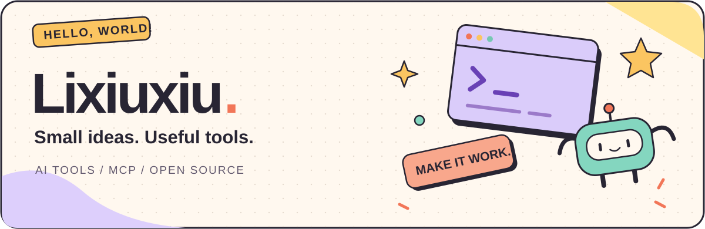
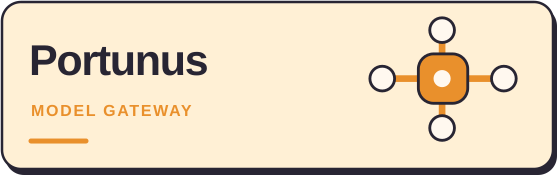
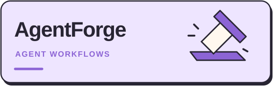
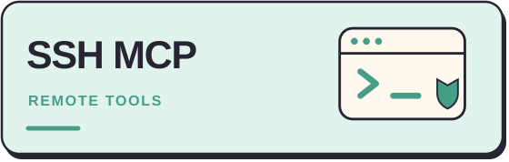

  

  <a href="./README.md">简体中文</a> · <strong>English</strong>

### Hi, I'm Lixiuxiu 👋

I build **AI developer tools and MCP services**, connecting models, tools, and workflows into useful products.
From desktop apps to self-hosted services, I enjoy turning small ideas into things that feel good to use.

  <a href="https://github.com/Lixiuxiu559?tab=repositories"><strong>Explore my projects ↗</strong></a>
  &nbsp; · &nbsp;
  <a href="https://hub.docker.com/u/lijx559">Docker Hub ↗</a>

### 🧩 A small universe of tools

<table>
  <tr>
    <td width="50%" valign="top">
      
      
Bring multiple model providers into one desktop app, with a shared endpoint, group routing, and call logs.

      
<code>Go</code> <code>Desktop</code> <code>LLM Gateway</code>

      <a href="https://github.com/Lixiuxiu559/portunus"><strong>Meet Portunus →</strong></a>
    </td>
    <td width="50%" valign="top">
      
      
Reusable agent workflows and engineering skills for requirements, design, implementation, and review.

      
<code>JavaScript</code> <code>Agent Skills</code>

      <a href="https://github.com/Lixiuxiu559/AgentForge"><strong>Open AgentForge →</strong></a>
    </td>
  </tr>
  <tr>
    <td width="50%" valign="top">
      
      
Connect MCP to remote servers, manage servers, credentials, and tokens, and keep an audit trail.

      
<code>Python</code> <code>FastMCP</code> <code>Docker</code>

      <a href="https://github.com/Lixiuxiu559/ssh-mcp"><strong>Connect with SSH MCP →</strong></a>
    </td>
    <td width="50%" valign="top">
      
      
Access PostgreSQL and Redis through MCP, with multiple instances, read-only safeguards, and audit logs.

      
<code>Python</code> <code>PostgreSQL</code> <code>Redis</code>

      <a href="https://github.com/Lixiuxiu559/db-mcp"><strong>Explore DB MCP →</strong></a>
    </td>
  </tr>
</table>

### 🎒 In my toolbox

`Python` · `Go` · `JavaScript` · `TypeScript` · `FastMCP` · `Docker` · `SQLite`

I like tools that run locally, clear interfaces, and logs that help explain what happened.

---

  <strong>Got an idea? Build it. ✦</strong> 
  Have a look around. Questions and ideas are welcome in each project's Issues.

