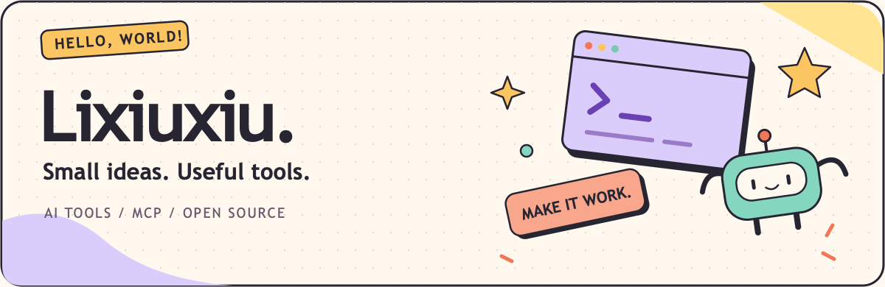
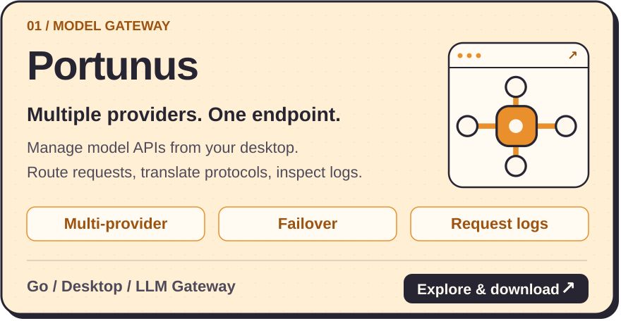
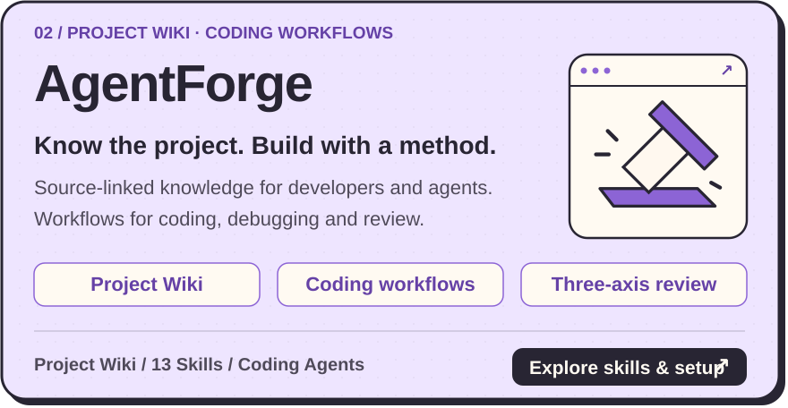
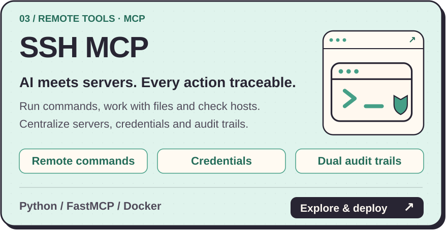
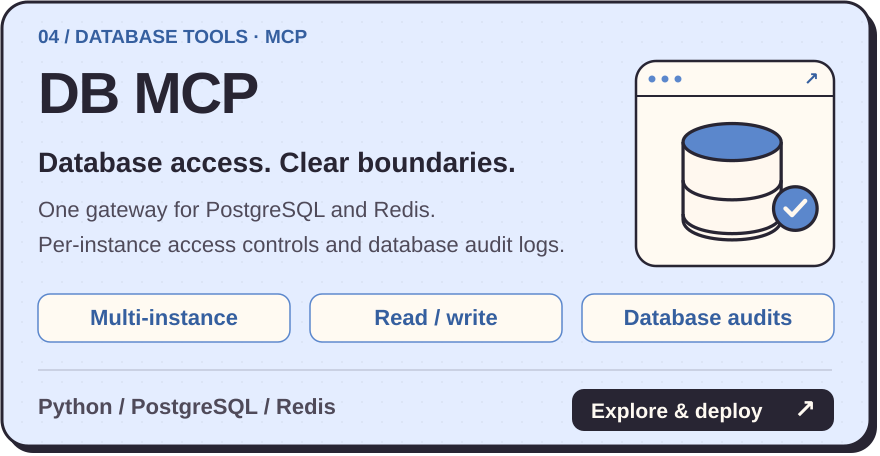

  

  <a href="./README.md">简体中文</a> · <strong>English</strong>

## Hi, I'm Lixiuxiu 👋

I build **AI developer tools and MCP services**, turning model access, project knowledge and tool calls into useful products.
From local desktop apps to self-hosted gateways, I care about straightforward setup, clear interfaces and understanding what happened when something goes wrong.

  <a href="https://github.com/Lixiuxiu559?tab=repositories"><strong>Explore all projects ↗</strong></a>
  &nbsp; · &nbsp;
  <a href="https://hub.docker.com/u/lijx559">Docker Hub ↗</a>

## Open-source projects I'm building

  <a href="https://github.com/Lixiuxiu559/portunus">
    <picture>
      <source media="(max-width: 600px)" srcset="./assets/projects/portunus.mobile.svg" />
      
    </picture>
  </a>

  <a href="https://github.com/Lixiuxiu559/AgentForge">
    <picture>
      <source media="(max-width: 600px)" srcset="./assets/projects/agentforge.mobile.svg" />
      
    </picture>
  </a>

  <a href="https://github.com/Lixiuxiu559/ssh-mcp">
    <picture>
      <source media="(max-width: 600px)" srcset="./assets/projects/ssh-mcp.mobile.svg" />
      
    </picture>
  </a>

  <a href="https://github.com/Lixiuxiu559/db-mcp">
    <picture>
      <source media="(max-width: 600px)" srcset="./assets/projects/db-mcp.mobile.svg" />
      
    </picture>
  </a>

## What I focus on

- **Model access:** bring provider and protocol differences behind a manageable endpoint.
- **Developer–agent collaboration:** make project knowledge navigable, changes evidence-based and validation explicit.
- **Tools connected to real systems:** use MCP to reach working environments while keeping access boundaries and audit trails.

In my toolbox: `Python` · `Go` · `JavaScript` · `TypeScript` · `FastMCP` · `Docker` · `SQLite`

---

  <strong>Got an idea? Build it. ✦</strong> 
  Questions, bugs and feature ideas are welcome in each project's Issues.

