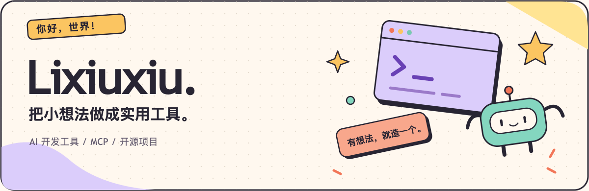
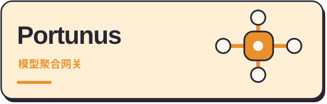
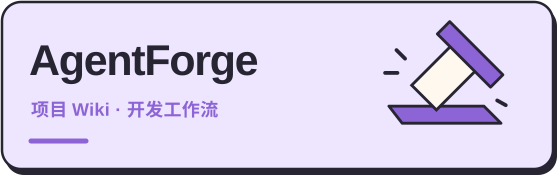
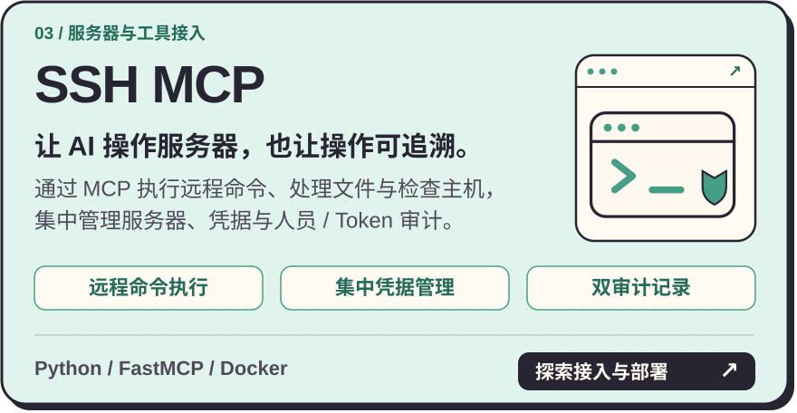
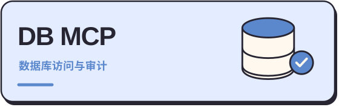

  

  <strong>简体中文</strong> · <a href="./README.en.md">English</a> · <a href="./assets/hello.zh-CN.png">静态版</a>

### 你好，我是 Lixiuxiu 👋

我在构建 **AI 开发工具与 MCP 服务**，把模型接入、项目知识和工具调用做成顺手的产品。
从本地桌面应用到自托管网关，我关心能否方便地接入、用清楚的界面管理，并在出问题时找到原因。

  <a href="https://github.com/Lixiuxiu559?tab=repositories"><strong>浏览全部项目 ↗</strong></a>
  &nbsp; · &nbsp;
  <a href="https://hub.docker.com/u/lijx559">Docker Hub ↗</a>

### 我在做的开源项目

<table>
  <tr>
    <td width="50%" valign="top">
      
      
<strong>多个模型渠道，一个本地入口。</strong>

      
在桌面端统一管理上游 API、模型分组与故障转移，处理协议转换，并查看调用记录。

      
<code>Go</code> <code>Desktop</code> <code>LLM Gateway</code>

      <a href="https://github.com/Lixiuxiu559/portunus/releases/latest"><strong>下载安装 →</strong></a>
      &nbsp; · &nbsp;
      <a href="https://github.com/Lixiuxiu559/portunus">了解项目</a>
    </td>
    <td width="50%" valign="top">
      
      
<strong>读懂项目，再有章法地交付代码。</strong>

      
为开发者与 Agent 生成可追溯的项目 Wiki，配合功能实现、Bug 调试、三轴评审和质量审计。

      
<code>Project Wiki</code> <code>13 Skills</code> <code>Coding Agents</code>

      <a href="https://github.com/Lixiuxiu559/AgentForge"><strong>查看技能与安装方式 →</strong></a>
    </td>
  </tr>
  <tr>
    <td width="50%" valign="top">
      
      
<strong>让 AI 操作服务器，也让操作可追溯。</strong>

      
通过 MCP 执行远程命令、处理文件和检查主机。集中管理服务器与凭据，分别审计人员配置和 Token 调用。

      
<code>Python</code> <code>FastMCP</code> <code>Docker</code>

      <a href="https://github.com/Lixiuxiu559/ssh-mcp"><strong>查看接入与部署 →</strong></a>
      &nbsp; · &nbsp;
      <a href="https://hub.docker.com/r/lijx559/ssh-mcp">Docker 镜像</a>
    </td>
    <td width="50%" valign="top">
      
      
<strong>连接数据库，保留读写边界与审计。</strong>

      
统一接入 PostgreSQL 与 Redis，按实例设置只读或读写，集中管理连接、凭据和数据库调用记录。

      
<code>Python</code> <code>PostgreSQL</code> <code>Redis</code>

      <a href="https://github.com/Lixiuxiu559/db-mcp"><strong>查看接入与部署 →</strong></a>
      &nbsp; · &nbsp;
      <a href="https://hub.docker.com/r/lijx559/db-mcp">Docker 镜像</a>
    </td>
  </tr>
</table>

### 我关注的方向

- **模型接入**：把多渠道与协议差异收进一个可管理的入口。
- **开发者与 Agent 协作**：让项目知识可查、改动有依据、验证有结果。
- **工具与系统连接**：通过 MCP 接入真实环境，保留访问边界与审计记录。

常用工具：`Python` · `Go` · `JavaScript` · `TypeScript` · `FastMCP` · `Docker` · `SQLite`

---

  <strong>有想法，就造一个。 ✦</strong> 
  使用问题、Bug 和功能建议，欢迎到对应项目的 Issues 里交流。

